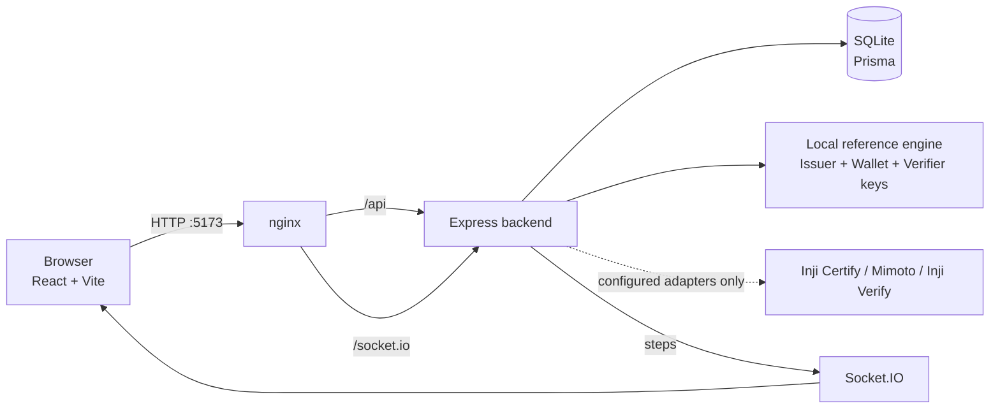

# Demo, Test and Submission Guide

This is the practical guide for showing the prototype and preparing the MOSIP Decode 2026 submission.
It is written in plain English and separates **what works today** from **what still needs a live Inji deployment**.

---

## 1. What the demo proves (in one minute)

The Playground can run a complete credential lifecycle **without Docker services or the MOSIP Collab sandbox**:

```
Issuer ── credential offer ──▶ Wallet
Wallet ── token + proof JWT ──▶ Issuer
Issuer ── signed credential ──▶ Wallet
Wallet ── signed presentation ──▶ Verifier
Verifier ── signature + nonce + issuer + expiry checks ──▶ PASS / FAIL
```

Every step is recorded and shown in the Protocol Inspector. The credential and presentation use **real Ed25519 keys and real signatures**. The verifier result is computed from those checks; it is not a hard-coded "pass".

The local stack supports:

- W3C VC JSON-LD (`ldp_vc`)
- SD-JWT VC (`vc+sd-jwt`, `dc+sd-jwt`) as a compact signed JWT
- Pre-authorized code flow (credential offer)
- Authorization code flow (redirect + consent)
- Both DID-based verifier identity (`did:jwk`) and separate verification-result retrieval

The external **Inji Certify / Mimoto / Inji Verify** adapters are still present and still honestly report that they need a configured deployment. The local stack is a reference implementation for the demo; it is not a claim that live Inji interoperability has been tested.

---

## 2. Run it in one command (Docker)

In plain words: this starts two small containers. One runs the backend and the database. The other
serves the web page. You open one link and the whole playground is ready.

Start Docker Desktop first. Then, from the repository root:

```bash
docker compose up --build
```

Then open:

```
http://localhost:5173/playground
```

What happens:

- `backend` builds the Express + Socket.IO + Prisma backend and stores SQLite in the named volume `demo-db`.
- `frontend` builds the React app and serves it through nginx.
- nginx proxies `/api` and `/socket.io` to the backend, so the browser uses one origin.
- The first build takes a few minutes; later starts are fast.
- Stop with `Ctrl+C`, or `docker compose down`. Add `-v` only if you deliberately want to delete the stored demo credentials.

If port `5173` or `4000` is already in use, change the published ports in `docker-compose.yml`.

No Node.js installation, database setup, `.env` file, or manual migration is required for this path.
The backend container creates the SQLite schema on first start.

Verified in this checkout on **27 Oct 2026**: `docker compose build` succeeds, both containers start,
the backend reports healthy, nginx serves the playground at `http://localhost:5173`, and the full
pass flow runs from the browser and through the same-origin API (`/api/health`, `/api/runs`) with no
extra setup.

---

## 3. Run it without Docker (development)

```bash
npm run setup      # npm install + prisma db push
npm run dev        # backend on :4000, frontend on :5173
```

If the environment already sets `PORT=0`, unset it or run `PORT=4000 npm run dev`; otherwise the backend binds an ephemeral port.

Open `http://localhost:5173/playground`.

Useful checks:

```bash
npm run typecheck
npm run build
cd backend && npm test
```

---

## 4. The 2–3 minute video script

Use this order. It keeps the story simple and shows the evidence.

| Time | What to show | What to say |
|---|---|---|
| 0:00 | Home page | "We built an interoperability playground for MOSIP Inji. A user picks an issuer, wallet and verifier, runs the lifecycle, and sees every protocol message." |
| 0:20 | Playground | "We have a self-contained local reference stack so the demo works without the Collab sandbox. It still uses real Ed25519 signatures and real verification." |
| 0:30 | Select `Local reference issuer / wallet / verifier`, format `ldp_vc`, flow `Pre-authorized code` | "This is the credential-offer flow used by Inji Mobile." |
| 0:40 | Click **Run end-to-end demo** | "The app issues a credential, stores it in the wallet, creates a presentation request, signs a presentation, and verifies it." |
| 0:55 | Result card | "Status is pass, verifier result is VALID, and evidence is server-verified." |
| 1:10 | Protocol Inspector | "Here are the actual messages: issuer metadata, credential offer, token with c_nonce, credential request with a proof JWT, signed credential, presentation definition, vp_token, and the separate verification result." |
| 1:40 | Expand `credential_request` and `vp_token` | "The proof JWT is signed by the holder's key and bound to the issuer's nonce. The VP is signed and bound to the verifier's nonce and DID." |
| 2:00 | Change flow to **Authorization code**, run again | "The same stack also supports the authorization-code flow. Inji Web uses this; Inji Mobile supports both." |
| 2:20 | Open Wallet → View | "The signed credential is persisted and can be inspected." |
| 2:35 | Close with limitations | "Live Inji Certify, Mimoto and Inji Verify integration is the next step; those adapters are present but blocked until endpoints are configured." |

Keep the video 2–5 minutes. Do not claim live Inji interop if the Inji adapters are not configured.

---

## 5. What is real and what is simplified

### Real in the demo

- Ed25519 key pairs for issuer, wallet/holder and verifier.
- A credential-request proof JWT (`typ: openid4vci-proof+jwt`) signed by the holder, with `aud` and `nonce`.
- A signed W3C VC (`DataIntegrityProof`, `eddsa-jcs-2022`) or a signed compact SD-JWT VC.
- A holder-signed Verifiable Presentation with `challenge` (nonce) and `domain` (verifier DID).
- Verification checks for issuer signature, holder signature, holder key binding, type, issuer identity, expiry and nonce replay.
- Separate verification-result retrieval after the wallet submission; HTTP 200 on submission alone is not treated as a pass.
- Persistence of the signed credential in SQLite and display in the Wallet page.
- Protocol steps pushed live over Socket.IO and stored for the Inspector.

### Deliberately simplified (say this in the pitch)

- The exchanges are **in-process**, not real HTTP between separate services. The Inspector records the protocol messages with `local.demo` URLs.
- JSON is canonicalised with sorted-key JCS-style JSON, not full JSON-LD RDF canonicalisation. Remote `@context` documents are not resolved.
- SD-JWT VC is a compact EdDSA JWS **without disclosures**; selective disclosure is not implemented in the demo.
- OpenID4VP uses the draft-23 Presentation Definition shape with a pre-registered local verifier; there is no JAR, response encryption or Inji Verify deployment.
- No `tx_code`/PIN, revocation/status list, trust registry, or HTTPS/Wallet trust framework.
- The local QR/URI artifacts are protocol artifacts; an external Inji wallet is not connected to the local demo.

These simplifications are documented so the demo can be honest and still useful. The Inji adapters and `docs/interop-gaps.md` describe the real integration blockers.

---

## 6. Test data

The demo creates a fresh holder key and credential on every run.

| Field | Value |
|---|---|
| Credential type | `InjiInteropDemoCredential` |
| Holder name | `Asha Rao` |
| Program | `MOSIP Decode 2026` |
| Purpose | `Interoperability playground demo` |
| Issuer | Local reference issuer (`did:jwk`) |
| Validity | 365 days |
| Formats | `ldp_vc`, `vc+sd-jwt`, `dc+sd-jwt` |
| Flows | `pre_authorized_code`, `authorization_code` |

No real personal data, sandbox UIN, client secret or P12 file is used.

---

## 7. Test cases and results

Run:

```bash
cd backend && npm test
npm run typecheck
npm run build
```

The suite currently contains **65 tests** (53 existing project/regression tests + 12 local-demo tests). All pass in the checked-out state.

| # | Test case | Expected | Result |
|---|---|---|---|
| 1 | Full pre-authorized flow (`ldp_vc`) | 9 steps, pass, VALID | Pass |
| 2 | Full authorization-code flow (`vc+sd-jwt`) | 10 steps including authorization, pass, VALID | Pass |
| 3 | All three demo formats issued end to end | pass, VALID | Pass |
| 4 | Tampered credential subject | INVALID, signature check fails | Pass |
| 5 | Expired credential | EXPIRED, not VALID | Pass |
| 6 | Tampered SD-JWT payload | INVALID | Pass |
| 7 | Credential proof JWT with wrong nonce/audience | rejected | Pass |
| 8 | Present with a different nonce (replay) | INVALID | Pass |
| 9 | Mixed local + Inji selection | HTTP 400 with a clear error | Pass |
| 10 | Executing an already terminal run | HTTP 409 | Pass |
| 11 | Wallet credential detail endpoint | returns the signed credential | Pass |
| 12 | Secret redaction (existing suite) | tokens/codes/proofs hidden | Pass |

The `docs/FORUM_NOTES.md` and `docs/PHASE0_NOTES.md` files contain the source-verified Inji endpoint research. Those are separate from the local demo.

---

## 8. API documentation (demo routes)

Base URL: `http://localhost:4000/api` (or same-origin `/api` through nginx).

### `GET /api/health`

```json
{ "ok": true, "phase": 1 }
```

### `GET /api/adapters`

Returns the issuer, wallet and verifier catalogue plus formats. The local reference stack is listed first and marked `ready`; Inji adapters remain `planned` until configured.

### `POST /api/runs`

```json
{
  "issuer": "local-issuer",
  "wallet": "local-wallet",
  "verifier": "local-verifier",
  "format": "ldp_vc",
  "kind": "workflow",
  "flow": "pre_authorized_code"
}
```

`format` is one of `ldp_vc`, `vc+sd-jwt`, `dc+sd-jwt`, `mso_mdoc`.
`flow` is `pre_authorized_code` (default) or `authorization_code`.
`kind` defaults to `workflow`; verification/issuance runs are used by the external adapter panels.

Response: `201` with the run, status `running`.

### `POST /api/runs/:id/execute`

Runs the local reference flow and records every step. Only allowed for a running `workflow` run whose three adapters are `local-issuer`, `local-wallet`, `local-verifier`.

Response: `200` with the updated run, including `status` (`pass`/`fail`), `verificationResult` (`VALID`/`INVALID`/`EXPIRED`), `verificationEvidence` (`server-verified`), `steps`, and `credential`.

Example:

```bash
RUN=$(curl -s -X POST http://localhost:4000/api/runs \
  -H 'content-type: application/json' \
  -d '{"issuer":"local-issuer","wallet":"local-wallet","verifier":"local-verifier","format":"ldp_vc","flow":"pre_authorized_code"}')

curl -s -X POST "http://localhost:4000/api/runs/$(echo "$RUN" | node -pe 'JSON.parse(fs.readFileSync(0)).id')/execute" \
  -H 'content-type: application/json' -d '{}'
```

### `GET /api/runs/:id`

Returns one run with its ordered steps.

### `GET /api/runs`

Returns run summaries.

### `GET /api/credentials`

Returns credential summaries (no credential body).

### `GET /api/credentials/:id`

Returns one stored credential, including its signed JSON/JWT body.

### Existing Inji integration routes

`GET /api/runs/:id/metadata`, `POST /api/runs/:id/offer`, `POST /api/runs/:id/steps`, `PATCH /api/runs/:id/status`, and `GET /api/verifier/config` are documented in the README and `docs/interop-gaps.md`. They remain blocked without configured external services.

### Socket.IO

- `run:subscribe` with a run id
- `run:unsubscribe`
- `run:step` (new recorded step)
- `run:update` (terminal status/verification result)

---

## 9. Architecture (one-command Docker)



The local engine signs and verifies every credential/presentation in the backend process. The Inji paths are optional and remain blocked until their environment variables are set and the deployments are reachable.

---

## 10. Submission checklist

The official MOSIP submission guidelines require the following. Status is for this checkout.

| Field | Status | What to do |
|---|---|---|
| Source code | Done | Push all changes to the GitHub repository; keep the history. |
| Working prototype/demo | **Done** | Docker one-command demo works; local demo passes. |
| Pitch presentation / slide deck | **Draft ready** | 7 slides + appendix with speaker notes in [`PITCH_DECK.md`](PITCH_DECK.md). Team: style and export to Google Slides/Canva. |
| Video demo (2–5 min) | Team-owned | Record using the script in section 4; the screenshots in `docs/screenshots/` show the exact views to capture. |
| Design mockups / wireframes | **Done** | Seven captured screens in [`docs/screenshots/`](screenshots/); the app's 4-step flow (Issue → Hold → Present → Verify) doubles as the user-flow diagram. |
| Architecture diagram | Done | Mermaid in section 9; paste into the deck. |
| Test data | Done | Section 6. |
| Test cases and results | Done | Section 7; rerun the commands before submission. |
| Usage and installation instructions | Done | Section 2/3 and README. |
| API documentation | Done | Section 8 and README. |
| Git repository with history | Ready to push | The phased commits are on `feat/ps02-working-prototype`; push the branch and confirm the repo is accessible. |
| College/university credentials | Team-owned | Each student uploads a valid college ID. |
| Submission email | Team-owned | Send team name, PS02 and all links to `decode@mosip.io`; deadline **2 Nov 2026** (extended 27 Oct 2026); make sure links are accessible. |

### Submission plan (deadline extended to 2 Nov 2026)

Deadline: **2 November 2026** (MOSIP extended it; announced 27 Oct 2026).

1. **First:** run `docker compose up --build`, click through the demo, fix any port conflict. Run `npm test`, `npm run typecheck`, `npm run build`.
2. **Midday:** record the 2–3 minute video using the script. Take 4–5 screenshots for the deck.
3. **Afternoon:** finish the pitch deck and the design/wireframe slides. Add the architecture diagram and test matrix.
4. **Evening:** verify the GitHub repo is accessible, all mandatory links are public, and email `decode@mosip.io` with team name, PS02 and URLs.

---

## 11. Known limitations (say them before a judge asks)

- No live Inji Certify, Mimoto or Inji Verify deployment in this checkout; those adapters correctly block instead of faking success.
- The local demo is a reference stack, not a conformance test of Inji's implementations.
- SD-JWT selective disclosure, revocation, `tx_code`, JAR, response encryption and trust registries are not implemented.
- The local demo uses one issuer key per backend process and one fresh holder key per run.
- SQLite is used for demo persistence; it is not a production database.
- The frontend bundle is large because it includes the Inji Verify SDK; this does not affect the demo.

See `docs/interop-gaps.md` for the source-verified Inji endpoint gaps and `PHASE4_REPORT.md`/`PHASE5_REPORT.md` for the earlier audit.

---

## 12. Screenshots (captured 27 Oct 2026, Docker stack)

These double as the design-mockup deliverable and the slide images for the deck.

| File | What it shows |
|---|---|
| `docs/screenshots/home.png` | Landing page: "One credential. Three interoperable experiences." |
| `docs/screenshots/playground-setup.png` | Playground selection UI: issuer, wallet, verifier, format, flow. |
| `docs/screenshots/playground-result.png` | Pass card: `pass`, `VALID`, `server-verified`, issued credential. |
| `docs/screenshots/inspector.png` | Protocol Inspector: the 9 recorded exchanges plus both QR artifacts. |
| `docs/screenshots/wallet-credential.png` | Wallet page with persisted, verified credentials. |
| `docs/screenshots/issuer-panel.png` | Issuer module: Inji Certify adapter honestly blocked until configured. |
| `docs/screenshots/verifier-panel.png` | Verifier module: Inji Verify SDK blocked until configured. |
