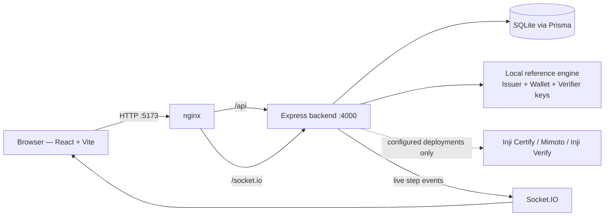

# Pitch Deck — Inji Interoperability Playground (PS02)

> **Status:** draft complete. Ready to copy into Google Slides / Canva / PowerPoint.
> **Length:** 7 core slides + appendix. This matches the event listing's "5–7 slide pitch" format.
> **Screenshots:** all images used below are in [`docs/screenshots/`](screenshots/) and were captured
> from the running Docker demo on **27 Oct 2026**.
> **Golden rule:** say only what the demo actually does. The "What is real" list below is your script.

---

## Slide 1 — Title

**Inji Interoperability Playground**
*A unified sandbox for verifiable-credential interoperability testing*

- Problem statement: **PS02 (MOSIP Decode 2026)**
- Team: `<team name>` — `<member names>`
- Repository: `https://github.com/garvitshrma/mosip-decode`

**One-liner (say this):**
"Pick an issuer, a wallet and a verifier, press one button, and watch a complete digital-credential
journey — issue, hold, present, verify — with every protocol message visible."

**In plain words:** it is one website where you can test if different digital-ID systems can talk to
each other, and see exactly where it breaks when they can't.

*(Screenshot suggestion: `home.png`)*

---

## Slide 2 — The problem

Digital credentials only work if three independent pieces understand each other: an **issuer** (makes
the credential), a **wallet** (stores it), and a **verifier** (checks it). When they come from
different teams, they often fail — and today it is hard even to test that:

- You need several separate services running before you can test anything.
- Sandbox environments are complicated to configure; test data and keys mismatch.
- When something fails, you usually see only "it didn't work" — not *which step* failed.
- Cross-stack testing (Inji ↔ other wallets like Animo or Hovi) is almost impossible to reason about.

**MOSIP's own mentors confirmed this in October 2026** and asked for exactly this kind of tool: a
**configurable playground** with an **Inji baseline** (Certify → Wallet → Verify) plus a few
**representative cross-stack scenarios** — not every possible combination — where the **protocol
steps and the failure point are visible**, and the **verification result comes from the verifier**,
never from a lucky HTTP 200.

*(Sources: community.mosip.io PS02 threads 2922, 2930 — see `FORUM_NOTES.md`.)*

---

## Slide 3 — The solution

**One web app that runs the whole credential lifecycle and shows everything.**

- Choose **issuer**, **wallet**, **verifier**, **credential format** (`ldp_vc`, `vc+sd-jwt`,
  `dc+sd-jwt`) and **issuance flow** (pre-authorized code / QR, or authorization code / redirect).
- Press **Run end-to-end demo** once.
- The app issues a credential with a **real Ed25519 signature**, stores it in a wallet, creates a
  presentation request, signs a presentation, and verifies it.
- The **Protocol Inspector** records every exchange (metadata, offer, token, proof JWT, credential,
  presentation request, VP token, verification result) with secrets redacted.
- **QR-ready artifacts** for the credential offer and the presentation request.
- The **Wallet page** shows the persisted signed credential.
- A **separate, server-computed verification result** — the app never treats "submission accepted" as
  "verification passed".

**In plain words:** the button does in one second what would normally take you an afternoon of
configuring five servers — and it keeps the receipts of every message.

*(Screenshot suggestion: `playground-setup.png`)*

---

## Slide 4 — Live demo (40 seconds)

Show, in this order:

1. Open `http://localhost:5173/playground` — keep the **local reference** stack, `ldp_vc`,
   pre-authorized code.
2. Click **Run end-to-end demo**.
3. **Result card:** `pass` · `VALID` · `server-verified` · 9 recorded steps.
4. **Protocol Inspector:** expand `credential_request` and `vp_token` — show the proof JWT bound to the
   issuer's nonce and the VP bound to the verifier's DID and nonce.
5. **Two QR artifacts:** credential offer and presentation request.
6. **Wallet page:** the stored signed credential.
7. Optional: switch the flow to **authorization code** and run again to show the extra `authorization`
   step (10 steps).

*(Screenshots: `playground-result.png`, `inspector.png`, `wallet-credential.png`.)*

**What judges should notice:** real keys and signatures, a verifier result that is computed from
actual checks, and every message on screen — this is the "make the protocol visible" requirement the
mentors asked for.

---

## Slide 5 — Architecture and tech stack

- **Frontend:** React + Vite + TypeScript.
- **Backend:** Express + TypeScript, Prisma + SQLite, Socket.IO for live step updates.
- **Cryptography:** Ed25519 keys; `eddsa-jcs-2022` Data Integrity proofs for `ldp_vc`; compact signed
  JWS for SD-JWT VC; `did:jwk` identities for issuer, holder and verifier.
- **Run it with one command:** `docker compose up --build` → open `http://localhost:5173/playground`.
  No Node, no database, no `.env` needed — the containers do everything.
- **Extensible by design:** issuers / wallets / verifiers / formats are catalogue entries; external
  adapters (Inji Certify, Inji Verify, Animo) plug into the same interface.

**In plain words:** two small containers — one serves the web page, one runs the logic and the
database. One command starts both.

*(Screenshot suggestion: reuse the Mermaid diagram in the deck, or export it as an image.)*

---

## Slide 6 — Evidence: tests and results

Checked on **27 Oct 2026** in this exact checkout:

- **65 of 65 backend tests pass** — including 12 local-demo tests: tampered credential, tampered
  SD-JWT, wrong proof nonce/audience, replay with a different nonce, expired credential, mixed
  local+Inji selection, terminal run, wallet detail endpoint, secret redaction.
- **TypeScript checks pass** across all three workspaces; **production build passes**.
- **All 5 format × flow combinations pass** through the live API: `pass` · `VALID` ·
  `server-verified` · 9–10 recorded steps each.
- **The Docker one-command stack was verified end to end through nginx** (browser → `/api` →
  backend → SQLite), not just in development mode.

| Check | Command | Result |
|---|---|---|
| Unit/regression tests | `cd backend && npm test` | 65/65 pass |
| Types | `npm run typecheck` | pass |
| Production build | `npm run build` | pass |
| Full Docker demo | `docker compose up --build` | healthy, full flow passes |

`DEMO_GUIDE.md` section 7 has the full test-case table.

---

## Slide 7 — Gaps, roadmap, impact

**Honest gaps (say them before a judge asks):**

- No live Inji Certify / Mimoto / Inji Verify deployment in this checkout — those adapters are present
  and **report clearly that they need configuration** instead of faking success.
- The lifecycle runs **in-process** (recorded with `local.demo` URLs), not over real HTTP between
  separate services.
- Simplifications: JCS-style canonicalisation (not full JSON-LD RDF), SD-JWT without selective
  disclosures, no JAR/response encryption, no revocation/status list, no trust registry.
- The QR codes are protocol artifacts; an external Inji wallet is **not** connected to this local demo.

**Roadmap (in the mentor-recommended order):**

1. Configure the real stack locally with Docker Compose: **Inji Certify `v1.0.0-alpha.1`** (issuer),
   **Mimoto + Inji Web** (wallet), **Inji Verify `v1.0.0-alpha.1`** (verifier).
2. Add the **Inji Web authorization-code launch** and the **mobile credential-offer QR handoff**
   (tunnel with ngrok/cloudflared for phones).
3. Build the **curated scenario matrix** the mentors asked for: Inji→Inji baseline, then
   External→Inji, Inji→External, External→External-with-Inji-Verifier — starting with an SD-JWT VC
   example against an external playground (Animo/Hovi).
4. Fetch the **authoritative verification result** from Inji Verify's result API
   (`GET /vp-result/{transactionId}`) in every scenario.
5. Keep every run's report: components, format, protocol **and version**, per-step result, overall
   result, failure point.

**Impact / target audience:**

- **Who it helps:** MOSIP teams and the wider Inji community; every team building an issuer, wallet
  or verifier; hackathon and ecosystem developers who need a reproducible way to test compatibility.
- **Why it matters:** interoperability failures are the hardest bugs in digital identity. This
  playground turns "it doesn't work" into "step 4 failed because the nonce didn't match" — with no
  sandbox required, on one laptop, in one command.
- **Relevance, creativity, usability, impact:** it is built directly on the mentors' guidance, runs
  anywhere via Docker, shows the protocol instead of hiding it, and is designed to grow with the
  ecosystem.

---

## Appendix (keep in the deck as backup slides)

### A1 — What is real vs simplified

Real: Ed25519 keys for issuer/holder/verifier; holder-signed proof JWT with `aud` + `nonce`; signed
W3C VC (`DataIntegrityProof`, `eddsa-jcs-2022`); signed compact SD-JWT VC; holder-signed VP with
`challenge` + `domain` (verifier DID); verification of issuer signature, holder signature, holder key
binding, type, issuer identity, expiry and nonce replay; separate verification-result step;
SQLite persistence; live Socket.IO steps.

Simplified: in-process transport; JCS-style canonicalisation (no remote `@context` resolution);
SD-JWT without disclosures; OpenID4VP draft-23 Presentation Definition shape with a pre-registered
local verifier; no `tx_code`, revocation, trust registry, or HTTPS.

### A2 — How the prototype maps to the mentors' guidance

| Mentor guidance (Oct 2026) | In the prototype | Next |
|---|---|---|
| Configurable playground, Inji + external stacks | issuer/wallet/verifier/format/flow selectors; external adapters listed | wire live deployments |
| Support both Certify flows; Web = auth code, Mobile = both | both flows run end to end | connect Inji Web launch |
| DID-based presentation request | verifier uses `did:jwk`, no pre-registration | unchanged |
| Result must come from the verifier, not HTTP 200 | separate `verification_result` step, `server-verified` | use Verify result API |
| Make protocol steps and failure point visible | Protocol Inspector with per-step rows | add stage-level verdicts |
| Start with Docker Compose, Collab later | one-command Docker stack | Collab config |
| Curated scenarios, not every combination | 5 format × flow combinations + negative tests | Animo/Hovi matrix |

### A3 — Mandatory submission fields → where they live

| Field | Where |
|---|---|
| Source code | this repository, `feat/ps02-working-prototype` branch, phased commits |
| Working prototype/demo | `docker compose up --build` → `http://localhost:5173/playground` |
| Pitch deck | this file (export to slides) |
| Video demo (2–5 min) | script in `DEMO_GUIDE.md` section 4 |
| Usage/installation | `README.md`, `DEMO_GUIDE.md` section 2–3 |
| API documentation | `DEMO_GUIDE.md` section 8, `README.md` API section |
| Git repository with history | this repo; keep commits, push the branch |
| College IDs | team uploads separately |
| Design mockups / wireframes | `docs/screenshots/` (7 captured screens) |
| Architecture diagram | `DEMO_GUIDE.md` section 9 / slide 5 |
| Test data, test cases & results | `DEMO_GUIDE.md` sections 6–7 |

### A4 — Say / don't say

Say: "The local reference stack runs the full lifecycle with real signatures, so the demo is
reproducible without the Collab sandbox." · "The Inji adapters are present but blocked until
configured; we do not claim live Inji interop." · "We support both issuance flows and three formats."
· "The verifier result is a separate, server-verified step."

Don't say: "We tested against Inji Certify/Verify" (not configured) · "OpenID4VCI/VP 1.0 conformant"
(it is a simplified demo profile) · "The QR works with Inji Wallet" (external handoff not connected).
